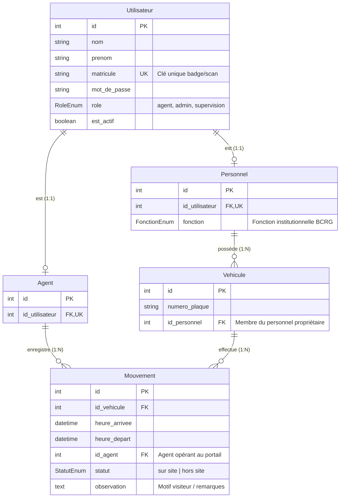

# 📄 Spécifications Métier & Matrix RBAC
## Application de Gestion du Parking Sous-Sol - BCRG (Banque Centrale de la République de Guinée)

---

## 1. Contexte & Définition Métier

L'application de gestion du parking sous-sol de la **Banque Centrale de la République de Guinée (BCRG)** est une solution digitale à haute sécurité destinée à :
- Tracer l'intégralité des flux véhiculaires (entrées et sorties) franchissant les portails du parking souterrain.
- Distinguer les accès du **Personnel BCRG** (identifié par badge/scan matricule et lié à une flotte autorisée) des accès **Visiteurs** (enregistrés avec motif et observation).
- Conserver un historique d'audit inaltérable associé à l'agent de sécurité responsable de chaque mouvement.
- Fournir aux autorités de contrôle un suivi analytique en temps réel du taux d'occupation et des affluences.

---

## 2. Matrice des Rôles & Droits d'Accès (RBAC)

Le système applique un contrôle d'accès basé sur trois rôles distincts (`RoleEnum`) :

| Rôle (`RoleEnum`) | Périmètre Visuel | Droits de Mutation (Créer / Modifier / Supprimer) | Tirage de Rapports & Exports |
| :--- | :--- | :---: | :---: |
| **`agent`** | Espace Guichet Vigile (`/vigile`) | **OUI** (Enregistrement d'entrée, marquage de sortie) | NON |
| **`admin`** | Espace Administration (`/admin`) | **OUI** (CRUD complet sur Utilisateurs, Personnel, Flotte, Mouvements, Rôles, Imports CSV/Excel) | **OUI** |
| **`supervision`** | Espace Administration (`/admin` - Vue Miroir) | **NON (Lecture Seule / Read-Only Strict)** | **OUI (Impression directe & Exports PDF/Excel uniquement)** |

### Règles Métier Spécifiques au Rôle `supervision` :
* Le profil **`supervision`** accède à la même interface et aux mêmes menus que l'**`admin`** (Dashboard, Plaque, Utilisateurs, Mouvements).
* **Restriction d'Écriture** : Les boutons d'ajout, de modification, de suppression ou de réinitialisation de mot de passe sont masqués ou désactivés pour ce rôle.
* **Droit Exclusif** : Impression directe des rapports officiels, filtrage avancé et export d'audits au format PDF/Excel.

---

## 3. Schéma du Modèle de Données (ERD)

---

## 4. Scénarios Opérationnels Fonctionnels

### A. Guichet Vigile (`/vigile`)
1. **Saisie rapide d'entrée Personnel BCRG** : Scan du QR Code/badge matricule -> Affichage instantané de la Carte Info Personnel -> Validation (`statut = "sur_site"`).
2. **Saisie d'entrée Visiteur** : Sélection du mode Visiteur -> Saisie de la plaque d'immatriculation + motif/observation -> Validation (`statut = "sur_site"`).
3. **Marquage de sortie** : Recherche de la plaque sur la liste des véhicules présents -> Action un clic *"Marquer la sortie"* (`statut = "hors_site"`, `heure_depart = NOW()`).

### B. Administration & Audit (`/admin`)
1. **Gestion de Flotte & Utilisateurs** : Creation, modification et attribution des rôles.
2. **Import de Masse** : Chargement de fichiers CSV/Excel pour l'initialisation du personnel et des véhicules.
3. **Supervision & Rapports** : Filtrage multicritères, analyse des tendances d'occupation et impression des procès-verbaux de contrôle.
